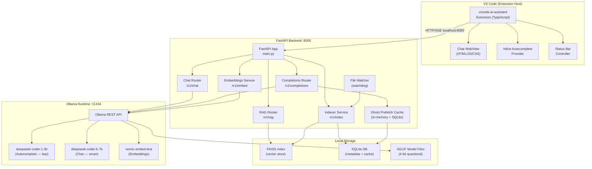
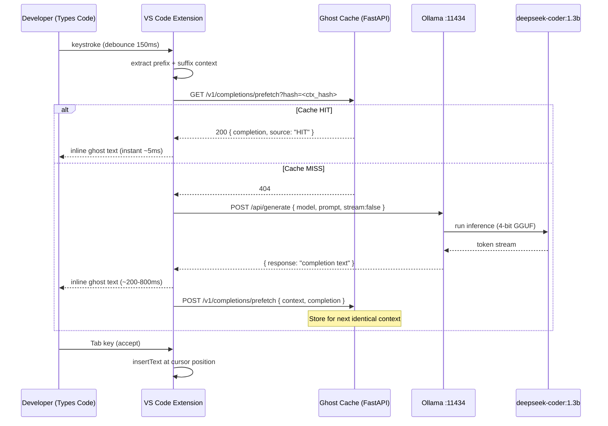
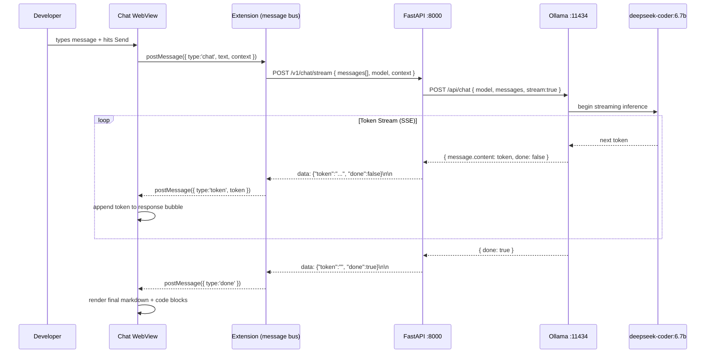
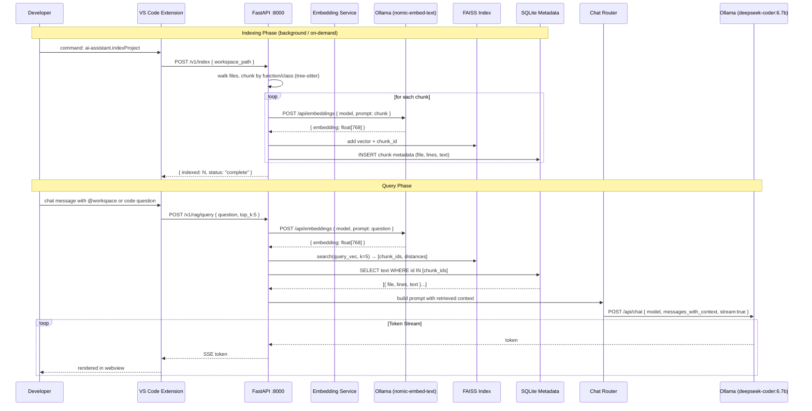
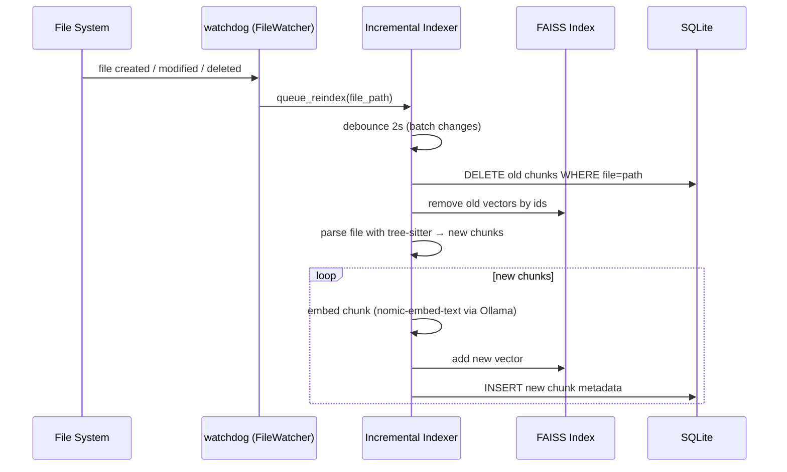
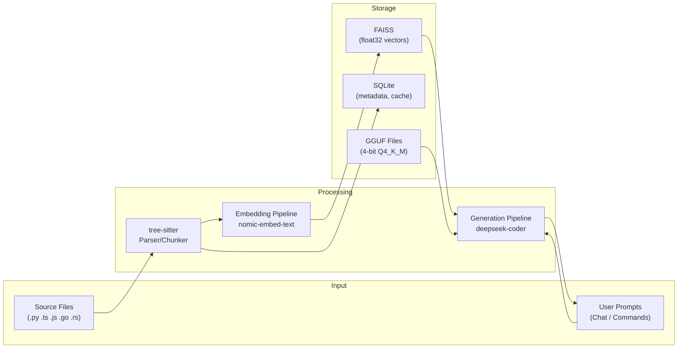

# ARCHITECTURE.md — Offline VS Code AI Assistant

## Overview

A fully offline, privacy-first AI coding assistant that runs entirely on a developer's local machine.
All inference, embeddings, and retrieval happen on `localhost` — no data ever leaves the machine.

---

## 1. System Component Diagram



---

## 2. Autocomplete Flow — Sequence Diagram



---

## 3. Chat Flow — Sequence Diagram



---

## 4. RAG Flow — Sequence Diagram



---

## 5. File Watcher Flow



---

## 6. Data Flow Architecture



---

## 7. Network Topology

```
┌─────────────────────────────────────────────────────────────┐
│                    Developer Laptop (localhost)               │
│                                                               │
│  ┌──────────────┐   HTTP/SSE    ┌──────────────────────────┐ │
│  │ VS Code      │──────────────>│ FastAPI  :8000           │ │
│  │ Extension    │<──────────────│ (Python + uvicorn)       │ │
│  └──────────────┘               └────────────┬─────────────┘ │
│                                              │ HTTP          │
│                                              v               │
│                                 ┌──────────────────────────┐ │
│                                 │ Ollama   :11434          │ │
│                                 │ (llama.cpp runtime)      │ │
│                                 │  ├─ deepseek-coder:1.3b  │ │
│                                 │  ├─ deepseek-coder:6.7b  │ │
│                                 │  └─ nomic-embed-text     │ │
│                                 └──────────────────────────┘ │
│                                                               │
│  NO EXTERNAL CONNECTIONS — 100% localhost                     │
└─────────────────────────────────────────────────────────────┘
```

---

## 8. Directory Structure

```
vscode-ai-assistant/
├── ARCHITECTURE.md
├── SYSTEM_DESIGN.md
├── .env
├── requirements.txt
├── package.json
├── tsconfig.json
├── webpack.config.js
├── setup.ps1
├── start.ps1
│
├── backend/                    # FastAPI Python backend
│   ├── main.py                 # App entry point, router registration
│   ├── config.py               # Settings (pydantic-settings)
│   ├── routers/
│   │   ├── completions.py      # POST /v1/completions
│   │   ├── chat.py             # POST /v1/chat/stream (SSE)
│   │   ├── rag.py              # POST /v1/rag/query
│   │   ├── embeddings.py       # POST /v1/embed
│   │   └── indexer.py          # POST /v1/index
│   ├── services/
│   │   ├── ollama_client.py    # httpx async Ollama wrapper
│   │   ├── faiss_store.py      # FAISS index manager
│   │   ├── sqlite_store.py     # SQLite metadata store
│   │   ├── prefetch_cache.py   # Ghost prefetch cache
│   │   ├── file_watcher.py     # watchdog integration
│   │   └── tree_sitter_parser.py  # Code chunker
│   └── models/
│       └── schemas.py          # Pydantic request/response models
│
├── src/                        # VS Code Extension TypeScript
│   ├── extension.ts            # Entry point, command registration
│   ├── chat/
│   │   ├── chatProvider.ts     # WebView provider
│   │   └── chatPanel.ts        # WebView HTML + message bus
│   ├── autocomplete/
│   │   ├── completionProvider.ts  # InlineCompletionItemProvider
│   │   └── prefetchClient.ts   # Ghost prefetch trigger
│   ├── rag/
│   │   └── indexCommands.ts    # Index project command
│   ├── api/
│   │   └── backendClient.ts    # Axios/fetch wrapper for FastAPI
│   └── ui/
│       ├── statusBar.ts        # Status bar item
│       └── webview/
│           ├── chat.html       # Chat UI
│           ├── chat.css        # Styles
│           └── chat.js         # Frontend logic
│
├── data/                       # Runtime data (gitignored)
│   ├── faiss_index/            # FAISS index files
│   └── chroma.db               # SQLite database
│
└── dist/                       # Compiled extension (gitignored)
    └── extension.js
```
